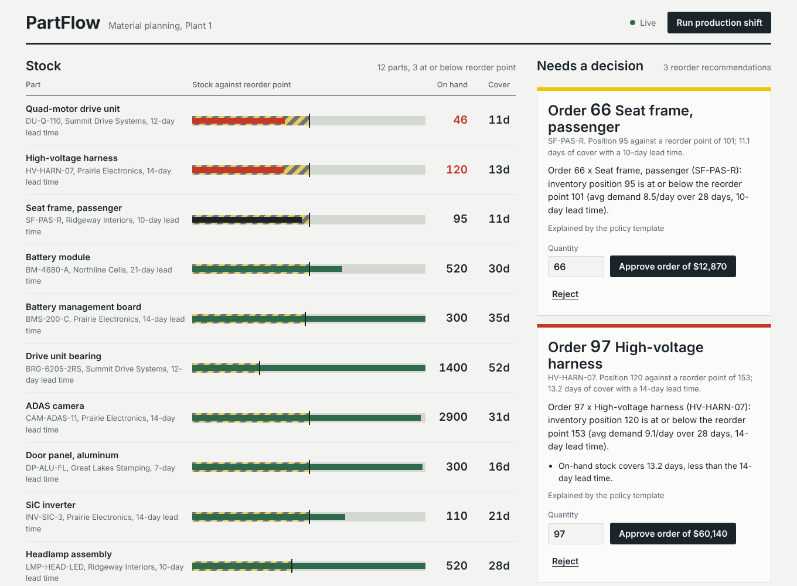
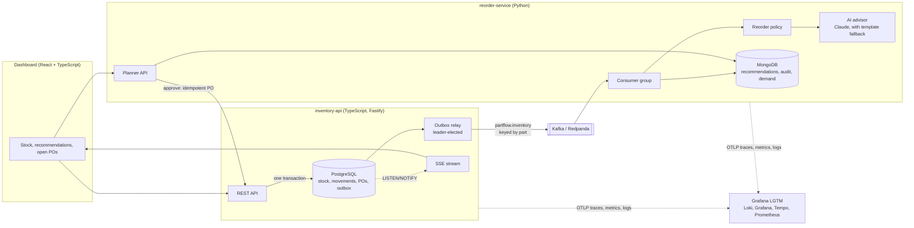

# PartFlow

[](https://github.com/Markkoby3/Partflow/actions/workflows/ci.yml)

Event-driven inventory and replenishment for a vehicle assembly plant. Line consumption, receipts and purchase orders are recorded in PostgreSQL, streamed through Kafka, and turned into reorder recommendations that a material planner approves or rejects from a live React dashboard. AI explains each recommendation; a deterministic policy decides the quantity.



## Architecture



| Component | Stack | Responsibility |
| --- | --- | --- |
| `services/inventory-api` | TypeScript, Fastify, PostgreSQL, KafkaJS, Zod | System of record for parts, stock, movements and purchase orders. Publishes domain events through a transactional outbox. |
| `services/reorder-service` | Python, FastAPI, confluent-kafka, MongoDB, Anthropic API | Consumes inventory events, estimates demand, applies the reorder policy, asks the AI advisor for an explanation, serves the planner API. |
| `web` | React 19, TypeScript, Vite | Planner dashboard with live updates over Server-Sent Events. |
| `observability` | OpenTelemetry, Grafana LGTM | Traces, metrics and logs from every service, plus a provisioned PartFlow dashboard. |
| `deploy/k8s` | Kubernetes, Kustomize | Deployments, Services, HPA and PDB for the three workloads. |

## Design decisions

**Transactional outbox, not dual writes.** A stock movement, the new stock level and its `inventory.stock_changed` event are written in one PostgreSQL transaction. The relay publishes outbox rows to Kafka afterwards, so an event exists if and only if the change committed. A broker outage delays events; it never loses or invents them.

**Ordered delivery with several API replicas.** Every replica runs the relay, but each tick takes a transaction-scoped advisory lock, so exactly one publishes at a time and events leave in commit order. Messages are keyed by part id, which keeps per-part order inside Kafka partitions.

**No overselling under concurrency.** Movements lock the part's stock row (`SELECT … FOR UPDATE`) and a `CHECK (on_hand >= 0)` constraint backs that up. A test fires 200 concurrent consumption requests at a part with 100 units: exactly 100 succeed, 100 get `409 insufficient_stock`, and stock ends at 0.

**Idempotency at every hop.** Clients may send an `Idempotency-Key` header on movements; purchase orders are unique per recommendation id, so a retried approval returns the same PO. The consumer is at-least-once: demand is keyed by movement id, part state only moves forward by a per-part `stockVersion`, and an event is marked handled only after every write succeeds.

**AI-first, with guardrails.** The reorder quantity comes from a deterministic policy: reorder point = mean daily demand × lead time + safety stock, with safety stock = z × σ × √lead time (z = 1.65, about a 95% service level), ordering up to lead time plus one review period. The advisor (Claude) only explains the decision and flags risks. Its output must validate against a strict schema; any error, timeout or missing key falls back to a template, so recommendations never wait on the model. Every decision is audited in MongoDB, including who approved it and any quantity override.

**Human in the loop, safely.** Approval first claims the recommendation (`pending → approving`), then creates the PO, then marks it `approved`. Without the claim, the PO's own stock event could reach the consumer first and supersede the recommendation mid-approval; there is a test for that race.

## Results

| Check | Result |
| --- | --- |
| Automated tests | 51 run locally (18 API integration tests against real PostgreSQL, 30 Python, 3 React), plus 3 broker and database integration tests and an end-to-end Kafka run in CI |
| Concurrency | 200 concurrent requests against 100 units: 100 committed, 100 rejected, zero oversell |
| Policy backtest | 40 synthetic parts over 180 days: 25% fewer stockout days and 53% less average stock than a static min/max rule (see below) |
| Load test | About 380 movements/s at p99 248 ms across 20 parts on a 2-vCPU dev VM with PostgreSQL on the same box (`npm run bench`) |

The backtest (`services/reorder-service/scripts/backtest.py`) replays the same seeded demand, with surges and lead times from 5 to 21 days, against two strategies that both review daily. The trade-off is order frequency: the policy places more, smaller orders.

| Strategy, seed 7 | Fill rate | Stockout days | Avg units on hand per part | Orders |
| --- | --- | --- | --- | --- |
| Static min/max from first 14 days | 97.7% | 170 | 491 | 237 |
| PartFlow policy | 98.3% | 127 | 229 | 851 |

These are synthetic results that test the policy logic, not measurements from a real plant.

## Run it

Everything, with Docker:

```bash
docker compose up --build -d
docker compose run --rm seed        # 5 suppliers, 12 EV parts, 28 days of line history
```

- Dashboard: http://localhost:5173 (use **Run production shift** to consume stock and watch recommendations appear)
- Grafana: http://localhost:3000, folder PartFlow; Explore has Tempo traces and Loki logs
- Inventory API: http://localhost:8080, reorder API: http://localhost:8090

Set `ANTHROPIC_API_KEY` before `docker compose up` to have Claude write the explanations; without it the template is used.

Developing a single service:

```bash
# inventory API (needs PostgreSQL; Kafka optional, without it events are marked published locally)
cd services/inventory-api && npm ci
TEST_DATABASE_URL=postgres://partflow@localhost:5432/partflow_test npm test
npm run dev

# reorder service
cd services/reorder-service && pip install -e ".[dev]" && pytest
uvicorn reorder.api:main_app --factory --port 8090
python -m reorder.consumer

# dashboard
cd web && npm ci && npm run dev
```

End-to-end check against a running stack: `python scripts/e2e.py`.

## API

Inventory API (`:8080`)

| Method and path | Purpose |
| --- | --- |
| `GET /v1/parts`, `GET /v1/parts/:id` | Parts with on-hand and on-order stock |
| `POST /v1/parts`, `PUT /v1/suppliers/:id` | Master data |
| `POST /v1/stock/movements` | Receipt, consumption or adjustment; optional `Idempotency-Key` header |
| `GET /v1/stock/movements?partId=` | Movement history, newest first |
| `POST /v1/purchase-orders` | Create a PO; idempotent on `recommendationId` |
| `POST /v1/purchase-orders/:id/receive`, `/cancel` | Close a PO and move stock |
| `GET /v1/stream` | Server-Sent Events, one per committed stock change |

Reorder API (`:8090`)

| Method and path | Purpose |
| --- | --- |
| `GET /v1/recommendations?status=pending` | Open recommendations with policy numbers and AI explanation |
| `POST /v1/recommendations/:id/approve` | Approve, optionally with a different quantity; creates the PO |
| `POST /v1/recommendations/:id/reject` | Reject with a reason |
| `GET /v1/assessments` | Latest reorder point, risk and days of cover per part |
| `GET /v1/decisions?partId=` | Audit trail |

## Repository layout

```
services/inventory-api   TypeScript service, migrations, outbox relay, tests, seed and load-test scripts
services/reorder-service Python consumer and API, reorder policy, AI advisor, backtest
web                      React dashboard
observability/grafana    Provisioned Grafana dashboard
deploy/k8s               Kustomize manifests
scripts/e2e.py           End-to-end check used by CI
```

## License

MIT
